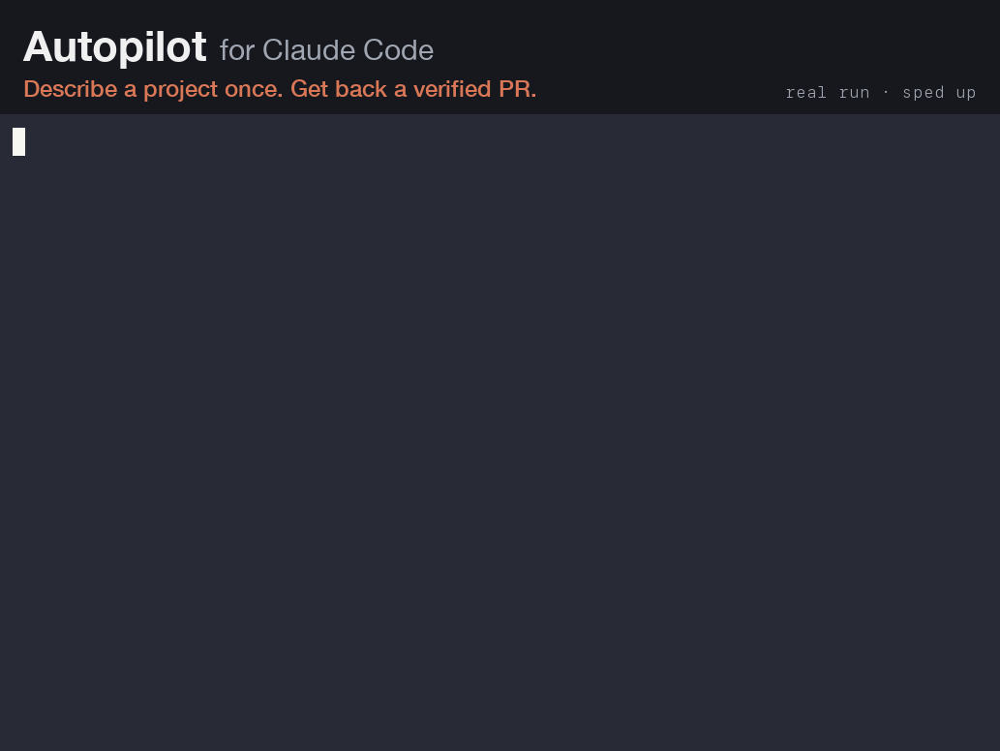

# Claude Code Playbook

A living, practical setup guide for [Claude Code](https://code.claude.com/docs): the principles, plus an installable baseline that configures any machine or VM the same way in one command.

It's built around three goals:
1. **Each project steers Claude well:** lean, layered context, so every session starts knowing how to build, test and ship the repo.
2. **Agents keep working while you have capacity:** isolation, a task queue, unattended verification and alerts, so parallel sessions don't stall.
3. **Resources aren't wasted:** context hygiene, the right model per job, and measuring before optimizing.

> Last reviewed: **2026-10-20** against Claude Code **v2.1.304**. See [docs/last-reviewed.md](docs/last-reviewed.md) and [how this guide stays current](docs/08-staying-current.md).

*Unofficial community project, not affiliated with or endorsed by Anthropic. "Claude" and "Claude Code" are trademarks of Anthropic.*

## Autopilot: describe a project once, get a verified PR



*A real run: Haiku builds a small landing page from a 5-criterion SPEC.md, verifies it (18 checks), and opens its own pull request on a throwaway GitHub repo, in about 1 min 45 s. The GIF is sped up; for readability, tool-call lines are cut to one row and paths shortened, and nothing else is changed. Recorded with [`docs/assets/record-autopilot-demo.sh`](docs/assets/record-autopilot-demo.sh).*

```text
claude                      # in an empty folder
> /autopilot-spec a CLI that converts Markdown tables to CSV
                            # the only interview of the run → SPEC.md with verifiable criteria
autopilot start             # background; survives closing the terminal
autopilot status | log | stop
```

Claude then works with no questions and no permission prompts until every acceptance criterion in `SPEC.md` is verified. It ends with `AUTOPILOT_DONE.md`, which lists each criterion with the command that proved it, and a pull request with a [PR doc and Mermaid diagrams](home/skills/open-pr/SKILL.md). If only a human can unblock it (a credential, a paid service, a product decision), it writes `AUTOPILOT_BLOCKED.md` and stops instead.

- **Waits out usage limits.** When the 5-hour or weekly window runs out, it sleeps until the reset and continues in the same session.
- **Never spends usage credits.** It refuses to start, and stops mid-run, if your account would bill paid credits beyond the plan.
- **Stays in its lane.** It works on its own branch, never pushes to the default branch, never merges, deploys or spends money. Hooks enforce the riskiest rules, not just the prompt.
- **Survives crashes and stalls.** It resumes the same session with backoff, keeps the machine awake, and marks itself blocked after three runs with no progress instead of looping forever.

Install just this part with `./install.sh --autopilot-only`. Full guide: [docs/09-autopilot.md](docs/09-autopilot.md).

### Requirements

| | |
|---|---|
| Plan | A Claude **Pro, Max or Team** subscription logged in to Claude Code. Autopilot refuses to run on API-key billing, on usage-based Enterprise plans, or with usage credits turned on, because there every token is paid. `AUTOPILOT_ALLOW_CREDITS=1` overrides this, at your own cost. |
| Claude Code | **v2.1.259 or later** (for `--permission-prompts none`); tested on v2.1.295 and v2.1.306 (the demo run). v2.1.305+ also re-checks whether a limit lifted early. |
| Permissions | Auto mode, or `AUTOPILOT_PERMISSION_MODE=dontAsk` if your organization disables it. `/goal` needs a trusted folder and hooks enabled (not `disableAllHooks` or `allowManagedHooksOnly`). |
| System | macOS or Linux (WSL2 works) with `bash`, `git` and `jq`. `gh` logged in if you want the final PR. |

### Before your first run

> [!WARNING]
> Autopilot runs an AI agent unattended, for hours, executing commands without asking you. The guard hooks block a short list of dangerous commands (recursive `rm` of `/` or `~`, force-push, pushing to the default branch, PRs without a doc), but they are a last line of defence, not a sandbox. **Do your first runs inside a VM, a container or a disposable user account**, on a repository you can throw away, and read [Permissions, autonomy and safety](docs/04-safety.md). You are responsible for what it does with your machine and accounts. The software is provided as is, without warranty ([MIT](LICENSE)).

One long run can also use a large share of your weekly allowance, which your interactive work shares. Use `AUTOPILOT_MODEL=sonnet` for big projects.

### Known limitations

- **Waiting at a real usage limit hasn't been observed end to end yet.** It can't be triggered on demand. The wait relies on Claude Code's documented `CLAUDE_CODE_RETRY_WATCHDOG`, with the runner reading `rate_limit_event.resetsAt` as a fallback, and both paths are covered by tests with a stub. If you hit a limit during a run, please [report how it went](../../issues/new?template=autopilot-run-report.yml).
- **The credits check reads the text of `claude -p /usage`.** If Anthropic rewords it, autopilot fails closed: it refuses to run rather than risk paid usage.
- **Closing a laptop lid still sleeps most Macs,** despite `caffeinate`, unless an external display is attached.
- **PRs need `gh`.** A PR opened through a GitHub MCP server bypasses the PR-doc hook.

## Quick start

```bash
git clone https://github.com/filipejesse/claude-code-playbook ~/claude-code-playbook
cd ~/claude-code-playbook
./install.sh --dry-run   # see exactly what will change
./install.sh             # apply (add --install-claude on a fresh VM)
```

Then, in each repository you work on, start `claude` and run `/bootstrap-project`.

Needs `bash`, `git` and `jq`. Works on macOS and Linux (including WSL2 and remote VMs). Reversible with `./install.sh --uninstall`. Only want autopilot? `./install.sh --autopilot-only` installs the `autopilot` command, `/autopilot-spec`, `/open-pr`, the `verifier` agent, the guard and PR-doc hooks and the permission rules, and leaves the rest out.

## What gets installed

All of it lives in [`home/`](home/), which is symlinked to `~/.claude/playbook`, so `git pull` updates every machine.

| Piece | What it does |
|---|---|
| [`CLAUDE.md`](home/CLAUDE.md) | A short global working agreement: verify with evidence, stay in scope, context hygiene, safe git. Imported from your `~/.claude/CLAUDE.md`; your own content stays. |
| [`settings.json`](home/settings.json) | Merged into yours, never replacing it. Adds allow rules for safe git/`gh` inspection; deny rules for `.env` files, SSH/cloud credentials and force-push; the hooks and status line below. |
| [`hooks/guard-bash.sh`](home/hooks/guard-bash.sh) | Blocks recursive `rm` of `/`, `~`, `.` or `*`, force-pushes, and pushes to the default branch. A last line of defence. |
| [`hooks/pr-doc-gate.sh`](home/hooks/pr-doc-gate.sh) + [`/open-pr`](home/skills/open-pr/SKILL.md) | Every PR ships with a committed doc in `docs/pr/` explaining what changed, why and how it was verified, with Mermaid diagrams (always a sequence diagram). The hook blocks `gh pr create` without it. |
| [`hooks/notify.sh`](home/hooks/notify.sh) | Desktop alert when a session needs you or finishes, so parallel agents don't sit idle. |
| [`statusline.sh`](home/statusline.sh) | Model · repo@branch · context % (color-coded) · cost · plan windows. |
| Agents: [`reviewer`](home/agents/reviewer.md), [`verifier`](home/agents/verifier.md), [`researcher`](home/agents/researcher.md) | Fresh-context review against the plan; checks with evidence and short output; sourced research. |
| Agent: [`frontend`](home/agents/frontend.md) + plugins [`impeccable`](https://github.com/pbakaus/impeccable), `frontend-design` | A UI specialist that starts with both design skills preloaded, follows the project's design system, and checks the rendered page at mobile and desktop widths. The global rules send UI work to it. The installer adds both plugins (`--no-plugins` to skip). See [frontend work](docs/03-context.md#frontend-work-skills-preloaded-into-a-specialist). |
| Skills: [`/bootstrap-project`](home/skills/bootstrap-project/SKILL.md), [`/handoff`](home/skills/handoff/SKILL.md), [`/next-task`](home/skills/next-task/SKILL.md) | Set up a repo for Claude; hand work to a fresh session; pull, implement, verify and PR the next queued task. |
| [`autopilot`](home/bin/autopilot) + [`/autopilot-spec`](home/skills/autopilot-spec/SKILL.md) | Describe a project once, then Claude builds it unattended until every acceptance criterion is verified and a PR is open. It waits out usage limits and resumes on its own, and only ever uses the subscription window, never paid usage credits. Linked to `~/.local/bin/autopilot`. |
| [`loop.md`](home/loop.md) | What a bare `/loop` does: continue → tend the PR → next task → stop. |
| [`templates/project/`](home/templates/project/) | Project `CLAUDE.md`, `.claude/settings.json`, `.worktreeinclude`, `TASKS.md`. |

## The guide

1. [Principles](docs/01-principles.md): the six ideas everything else follows from
2. [Setting up a machine](docs/02-setup.md): install, VMs, work and personal accounts, Enterprise caveats
3. [Context engineering](docs/03-context.md): CLAUDE.md layers, rules, skills, handoffs
4. [Permissions, autonomy and safety](docs/04-safety.md): modes, rules, sandbox, hooks
5. [Running work in parallel](docs/05-parallel.md): subagents, worktrees, `/batch`, agent view
6. [Keeping agents busy](docs/06-keeping-agents-busy.md): queues, `/loop`, `/goal`, scheduled tasks, usage windows
7. [Cost and usage](docs/07-cost-and-usage.md): what drives spend and the levers that matter
8. [Staying current](docs/08-staying-current.md): how this repo keeps itself up to date
9. [Autopilot](docs/09-autopilot.md): build a whole project unattended, through usage limits

## A day with this setup

```text
morning   claude (Opus, plan mode) → turn the next feature into 5-10 `agent-ready` issues
          claude --bg --model sonnet "/loop /next-task"      # one worker per repo
          claude agents                                       # watch: needs input / ready for review
daytime   alerts fire → answer questions from agent view, review PRs with the evidence attached
evening   /schedule a nightly cloud run of /next-task for the repos that allow it
weekly    /refresh-guide in this repo → review the PR → git pull everywhere
```

## Tests

```bash
tests/run.sh   # runs the installer, merge, uninstall and hooks against a throwaway HOME
```

CI runs the same suite on Ubuntu and macOS.

## Contributing

Issues and PRs are welcome, especially reports from real autopilot runs and corrections when Claude Code changes. See [CONTRIBUTING.md](CONTRIBUTING.md). To report a way around a guard hook, follow [SECURITY.md](SECURITY.md) instead of opening a public issue.

## License

[MIT](LICENSE). Not affiliated with Anthropic.
