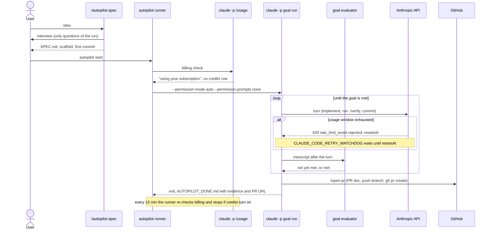
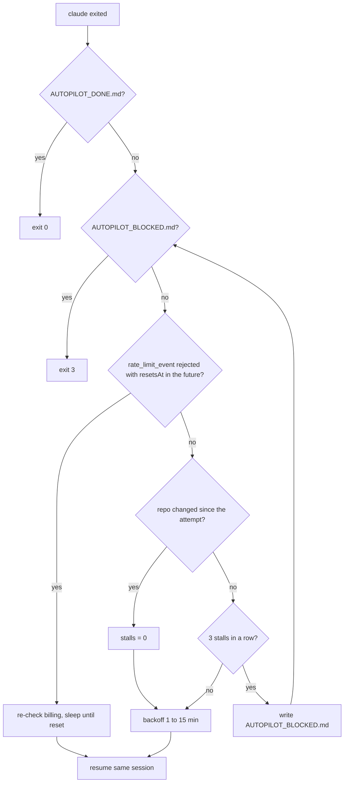
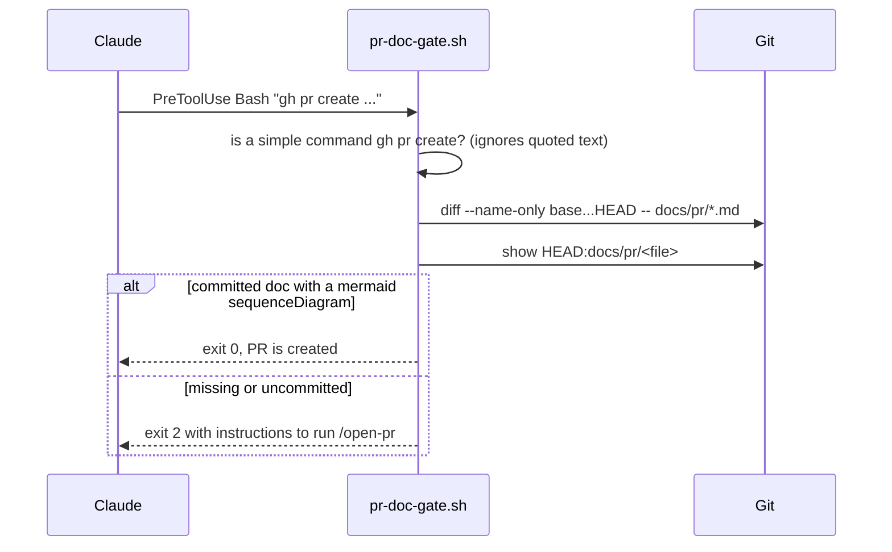

# Autopilot, PR docs, and a no-credits guarantee

## Summary
Adds a way to build a whole project unattended: `/autopilot-spec` runs the only interview and writes a verifiable `SPEC.md`, then `autopilot` drives Claude until every criterion is verified and a PR is open. Runs only ever use the subscription's usage window: autopilot refuses to start, and stops mid-run, if usage credits are on, and it waits for the window to reset instead of failing. Also makes "every PR ships with a doc with Mermaid diagrams" a harness rule enforced by a hook, and blocks pushes to the default branch.

## Changes
- Autopilot runner: goal, auto mode, no questions, usage-limit wait, resume, keep-awake, credits guard (`home/bin/autopilot`)
- Spec interview and scaffold, with optional private GitHub repo (`home/skills/autopilot-spec/SKILL.md`)
- PR doc rule: skill, hook and global agreement (`home/skills/open-pr/SKILL.md`, `home/hooks/pr-doc-gate.sh`, `home/CLAUDE.md`)
- Guard blocks `git push` to the default branch (`home/hooks/guard-bash.sh`); allow rules for branch pushes and `gh pr create` (`home/settings.json`)
- Installer links `~/.local/bin/autopilot` (`install.sh`)
- Guide 9 plus updates to guides 4 and 6, README, CHANGELOG
- Tests: 99 cases, including a stub `claude` for the runner (`tests/run.sh`)

## How it works

### An autopilot run

### Runner decisions after claude exits

### PR doc gate

## Verification
| Check | Command | Result |
|---|---|---|
| Test suite | `tests/run.sh` | 102 passed, 0 failed |
| Real run (Haiku), billing preflight against real `/usage` | `autopilot run <tmp project>` | DONE in 26-38 s, `./verify.sh` ok, `usage.txt` shows subscription billing |
| Real session, push to main | `claude -p` asked to run `git push origin main` | Blocked by guard; bare remote stayed empty |
| Real session, PR without doc | `claude -p` asked to run `gh pr create` | Blocked by pr-doc-gate |
| Settings accepted | `claude doctor` | no rejected entries |
| CI | GitHub Actions (Ubuntu, macOS, ShellCheck) | see PR checks |

## Risks and follow-ups
- Not verified live: the wait at an actual usage limit (can't be triggered on demand). It relies on the documented `CLAUDE_CODE_RETRY_WATCHDOG` behavior and on the `rate_limit_event` fallback.
- The credits check matches `/usage` text; if Anthropic changes that wording, autopilot fails closed: it refuses to run rather than risk spending credits.
- PRs opened through a GitHub MCP server bypass the gate; the global rule says to use `/open-pr` (`gh`).
- Closing a laptop lid still sleeps most Macs despite `caffeinate`.
