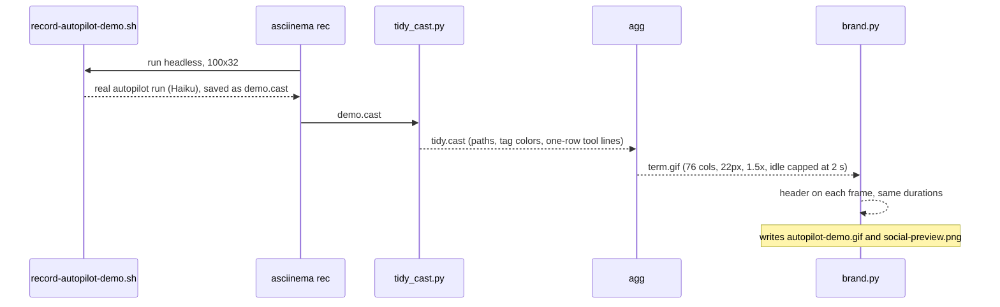

# Demo GIF readable on phones, with a title header; social preview image

## Summary
The demo GIF from #2 used 100 columns at 14px. On a phone, where most people will first see it in a post on X, the text was unreadable. This PR re-renders the same recording, without running autopilot again, at 76 columns and 22px with a title header. It also adds a 1280x640 social preview image for the repo's link card, and the scripts that produce both. The README caption now states exactly what was changed for display, and that the demo project has no remote, so the run stops before the PR step.

## Changes
- Demo GIF re-rendered: 76 cols, 22px SF Mono, header "Autopilot for Claude Code / Describe a project once. Get back a verified PR.", about 33 s (`docs/assets/autopilot-demo.gif`)
- Social preview, 1280x640, for Settings → Social preview (`docs/assets/social-preview.png`)
- `tidy_cast.py`: display-only cleanup of the recording. Shortens the temp path to `./`, colors the `tool`/`say`/`end` tags, and cuts `tool` lines to one row. Claude's messages and all other output are unchanged (`docs/assets/tidy_cast.py`)
- `brand.py`: adds the header to every frame, keeping frame timing, and draws the social preview (`docs/assets/brand.py`)
- Recording instructions and README caption updated (`docs/assets/record-autopilot-demo.sh`, `README.md`)

## How it works

## Verification
| Check | Command | Result |
|---|---|---|
| Display cleanup changes only what it says | `diff` of event lines from tidy runs; manual frame review | events identical across runs; frames reviewed at the start, middle and end |
| GIF size and length | Pillow: frame sizes and durations | 1033x776, 31 frames, 33.4 s, 2.4 MB (X allows 15 MB) |
| Social preview size | Pillow | 1280x640 PNG, 189 KB (GitHub recommends 1280x640, under 1 MB) |
| Scripts | `python3 -m py_compile docs/assets/*.py`; `shellcheck --severity=warning docs/assets/*.sh` | ok |
| Test suite | `tests/run.sh` | 110 passed, 0 failed |

## Risks and follow-ups
- The demo project has no GitHub remote, so the GIF doesn't show the PR step, and the caption says so. To show it, record a run against a throwaway GitHub repo. That would also be the first live end-to-end check of autopilot opening its own PR.
- The social preview is not applied automatically: GitHub only accepts it through Settings → Social preview.
- `brand.py` uses macOS system fonts.
