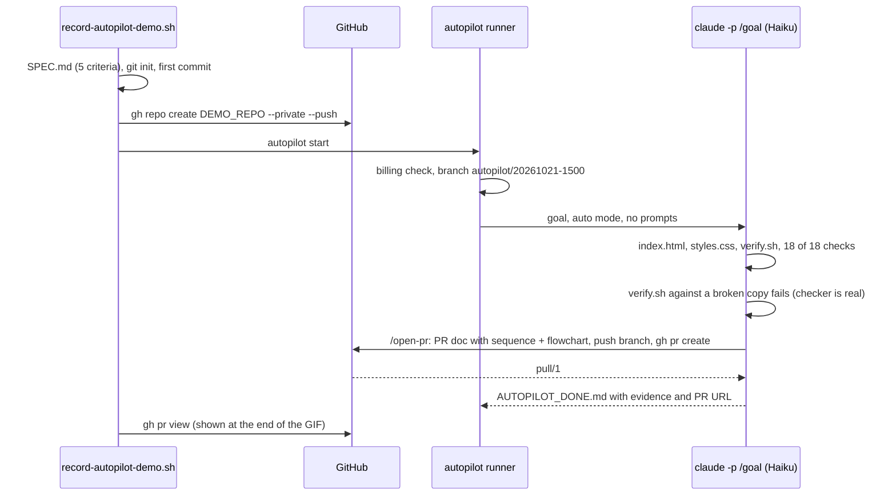
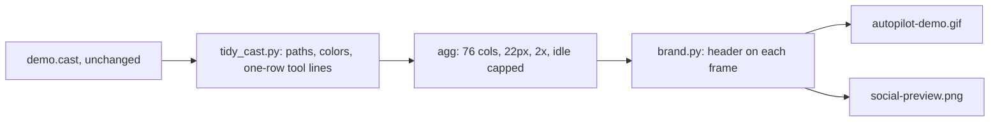

# Demo of a real run that opens its own PR; GIF readable on phones; two runner log fixes

## Summary
The first demo GIF (#2) stopped before the PR step, because the demo project had no remote. It was also too small to read on a phone. This PR records a new real run against a throwaway private GitHub repo, [`autopilot-demo-landing`](https://github.com/filipejesse/autopilot-demo-landing/pull/1). Autopilot builds a small landing page from a 5-criterion SPEC.md, verifies it with 18 checks, and **opens its own pull request with a PR doc**, in about 1 min 45 s. It is the first live end-to-end check of that step. The GIF is rendered at phone-readable size with a title header. A social preview image is added. Recording the demo also surfaced two cosmetic runner bugs, fixed here with regression tests.

## Changes
- Demo script now builds the "Acme Notes" landing page and, with `DEMO_REPO` set, creates that repo private and lets autopilot open its PR (`docs/assets/record-autopilot-demo.sh`)
- New GIF: 76 cols, 22px, title header, about 39 s, ending on the PR URL and its files (`docs/assets/autopilot-demo.gif`)
- Social preview, 1280x640, for Settings → Social preview (`docs/assets/social-preview.png`)
- `tidy_cast.py`: display-only cleanup (temp paths → `./`, colored tags, one row per tool call). `brand.py`: header on every frame, same timing; draws the social preview (`docs/assets/`)
- Runner fix: `autopilot start` sent the runner's stderr to `autopilot.log`, where `log()` already writes, so every line appeared twice. Stray output now goes to `.autopilot/runner.out` (`home/bin/autopilot`)
- Runner fix: on the first attempt, `wc -l <events.jsonl` printed "No such file" because the redirection failed before `2>/dev/null` applied. It is now wrapped in a group (`home/bin/autopilot`)
- Two regression tests for `start` (`tests/run.sh`); README caption and CHANGELOG

## How it works

### The recorded run

### From recording to assets

## Verification
| Check | Command | Result |
|---|---|---|
| Real run, end to end | `DEMO_REPO=filipejesse/autopilot-demo-landing asciinema rec … record-autopilot-demo.sh` | Claude Code 2.1.306, Haiku: DONE in 1 min 43 s; PR [autopilot-demo-landing#1](https://github.com/filipejesse/autopilot-demo-landing/pull/1) with `docs/pr/…md` (sequenceDiagram + flowchart), not merged |
| Result renders | page served locally, viewed at 375 px and 1280 px | hero, 3 features, 2 plans, footer; one spacing nit (the Pricing heading touches the feature cards), not covered by the structural SPEC |
| Display cleanup only | `diff` of event lines across tidy runs; frames reviewed at the start, middle and end | events unchanged apart from the stated cleanup |
| GIF | Pillow | 1033x776, 53 frames, 38.9 s, 4.0 MB (X allows 15 MB) |
| Runner fixes | `tests/run.sh` with and without the fix | with: 112 passed, 0 failed. Without: the 2 new tests fail |
| Lint | `shellcheck --severity=warning install.sh tests/run.sh home/statusline.sh home/hooks/*.sh home/bin/autopilot docs/assets/*.sh`; `python3 -m py_compile docs/assets/*.py` | ok |

## Risks and follow-ups
- The demo repo is private. Make it public too if the post should link to the PR it opened, or delete it after posting.
- The social preview is not applied automatically: GitHub only accepts it through Settings → Social preview.
- `brand.py` uses macOS system fonts.
- Still not observed live: the wait at a real usage limit.
