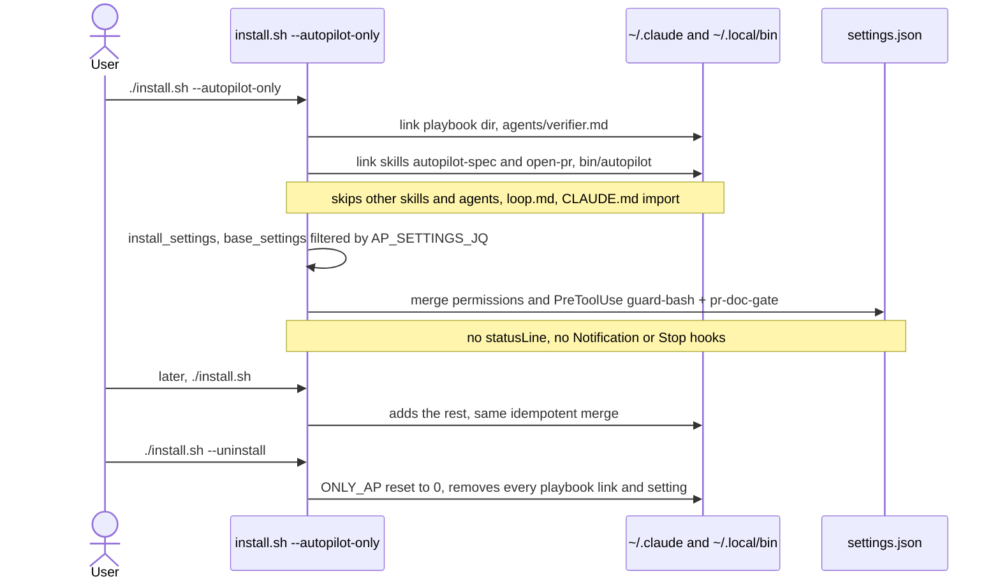
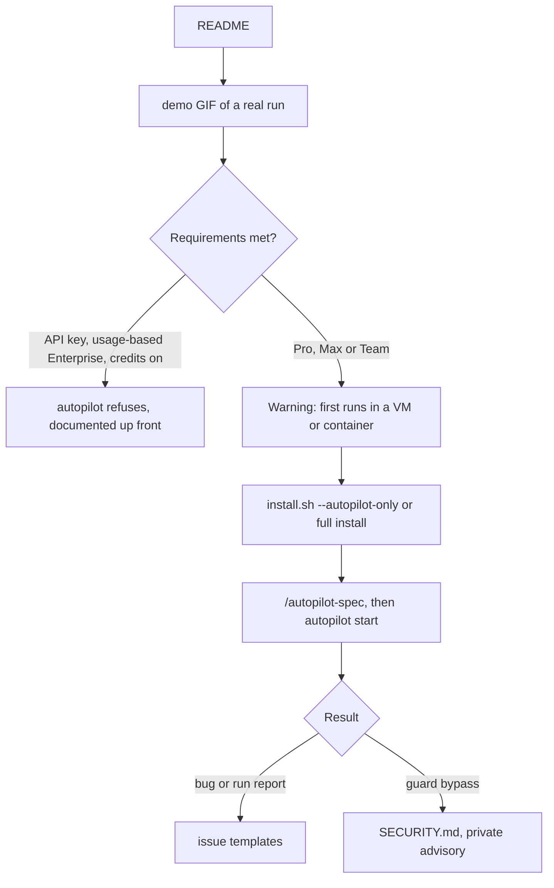

# Prepare for open source: autopilot-first README, `--autopilot-only`, community files

## Summary
The repo is about to go public, and most newcomers will come for autopilot. Before this PR, autopilot was one row in a table, and the README didn't say what it needs or risks. Now the README opens with a recorded real run, the requirements (plan, Claude Code version, permissions), a safety warning, known limitations and an "unofficial" notice. `./install.sh --autopilot-only` lets people try autopilot without adopting the whole playbook. CONTRIBUTING, SECURITY and issue templates set up the community side.

## Changes
- README: autopilot section with the demo GIF, requirements, safety warning, known limitations, contributing, not-affiliated notice (`README.md`)
- Guide 9: requirements section (`docs/09-autopilot.md`)
- Installer: `--autopilot-only` links only `autopilot`, `/autopilot-spec`, `/open-pr` and the `verifier` agent. It merges only the permission rules plus the guard and PR-doc hooks: no global `CLAUDE.md` import, status line or notifications. `--uninstall` always removes everything (`install.sh`)
- Tests: 8 new cases for `--autopilot-only`, including a later full install and uninstall (`tests/run.sh`)
- Demo: a real run recorded with asciinema and rendered with agg, plus the script to re-record it (`docs/assets/`)
- Community: `CONTRIBUTING.md`, `SECURITY.md` (private reports for guard bypasses), issue templates for bugs and autopilot run reports (`.github/ISSUE_TEMPLATE/`)
- CI: ShellCheck now also covers `home/bin/autopilot` and `docs/assets/*.sh`, which it skipped before (`.github/workflows/ci.yml`)

## How it works

### Autopilot-only install

### What a newcomer meets

## Verification
| Check | Command | Result |
|---|---|---|
| Test suite | `tests/run.sh` | 110 passed, 0 failed (was 102) |
| ShellCheck, now including the runner and demo script | `shellcheck --severity=warning install.sh tests/run.sh home/statusline.sh home/hooks/*.sh home/bin/autopilot docs/assets/*.sh` | no warnings |
| Dry run on a machine with the full install | `./install.sh --dry-run --autopilot-only` | lists only the autopilot pieces; settings "no changes" |
| Demo is a real run | `docs/assets/record-autopilot-demo.sh` under `asciinema rec` | Claude Code 2.1.306, Haiku, `end success` in about 70 s; `AUTOPILOT_DONE.md` with 3/3 criteria; `./slugify "  Ship It -- Now!! "` → `ship-it-now` |
| No personal data in the recording | `grep -c <username> demo.cast` | 0 |
| PR gate on this PR | `gh pr create` in the same command as the doc's commit | blocked: the hook runs before the command, so the doc was not yet committed. Committed first, then opened |
| CI | GitHub Actions | see PR checks |

## Risks and follow-ups
- The repo is still private. Making it public is the owner's call. After that, enable private vulnerability reporting (Settings → Security) so the SECURITY.md link works.
- Commits before this PR carry the owner's personal email. History is not rewritten; new commits from this clone use the GitHub noreply address.
- The GIF is 1.8 MB. Re-record it if autopilot's output format changes.
- The README states that the wait at a real usage limit hasn't been observed end to end yet, and asks for run reports.
