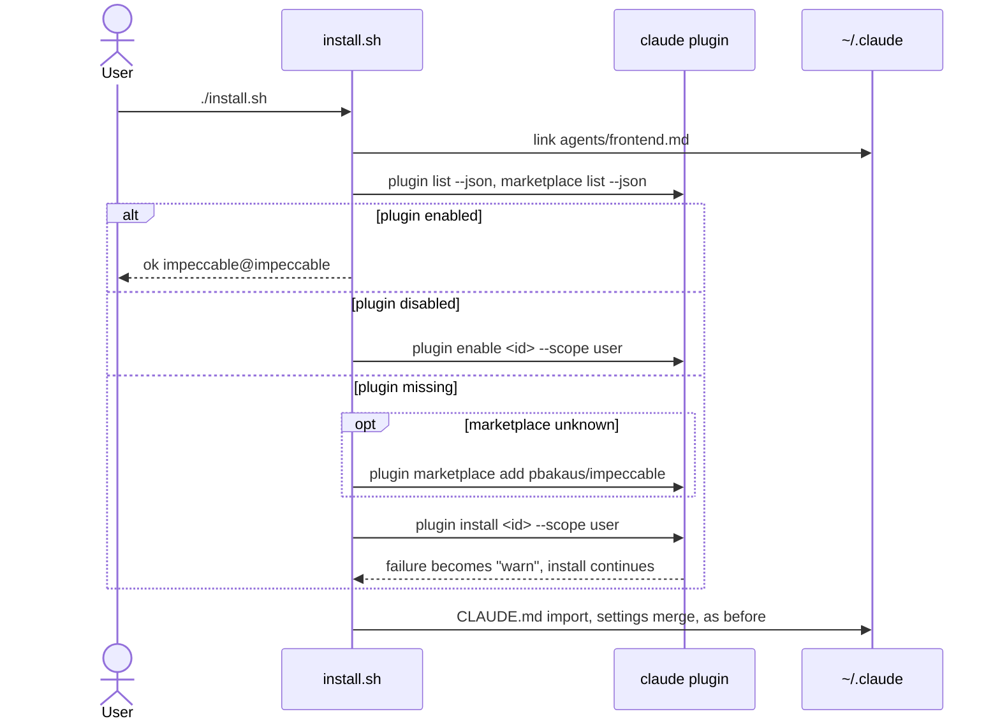
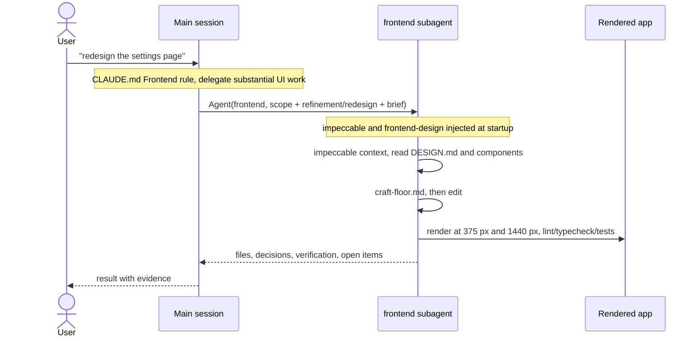
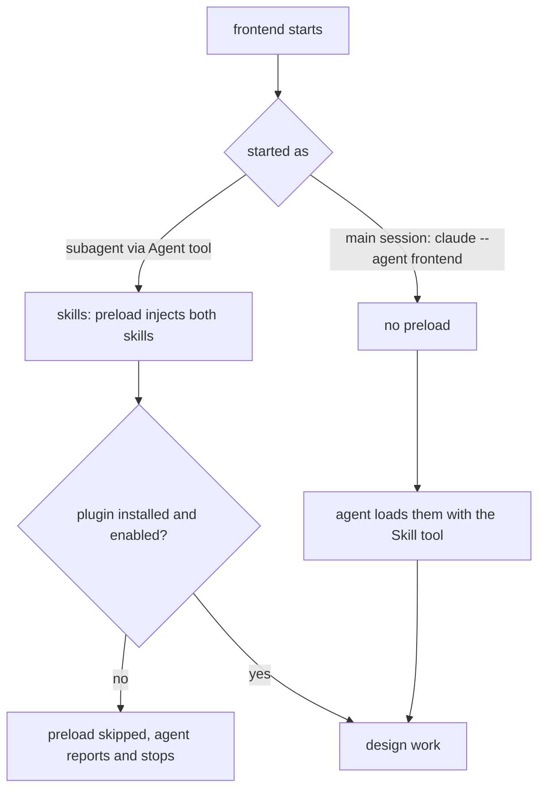

# Frontend specialist: a `frontend` subagent with impeccable and frontend-design preloaded

## Summary
UI work drifted to generic defaults because each session decided on its own whether to use the design skills. This PR adds a `frontend` subagent that starts with the `impeccable` and `frontend-design` skills preloaded through `skills:` frontmatter. A new Frontend section in the global working agreement sends UI work to it. A missing plugin only gets a debug-log warning when the preload skips it, so `install.sh` now installs both plugins itself, and `--no-plugins` turns that off.

## Changes
- Agent: `frontend`, with both skills preloaded and model `opus`. Its workflow is impeccable's context launcher, then the sub-command playbook, then the craft floor; frontend-design sets the direction for new work. It reads the project's design system first, decides between refinement and redesign, builds the full set of states, checks the rendered page at ~375 px and ~1440 px, and treats accessibility as part of done. If a skill didn't load, it says so and stops (`home/agents/frontend.md`)
- Global agreement: Frontend section. UI work follows the two skills, substantial UI work goes to `frontend`, and the project's `DESIGN.md` beats generic taste (`home/CLAUDE.md`)
- Installer: a "Frontend plugins" step with `install_plugins` and `run_plugin`. It adds the impeccable marketplace if it's missing, installs at user scope, re-enables disabled plugins, and skips installed ones. Failures produce a warning but don't stop the install. Without `claude` it prints the commands to run. Dry runs change nothing. `--autopilot-only` and `--no-plugins` skip the step, and uninstall keeps the plugins (`install.sh`)
- Tests: a stub `claude` that logs calls and keeps plugin state, so the suite never touches real plugins. 11 new checks, and the existing direct installer calls now go through the stub (`tests/run.sh`)
- Docs: a README row, a row in the setup table, a "Frontend work" section in the context guide (including the main-thread limitation), and the changelog (`README.md`, `docs/02-setup.md`, `docs/03-context.md`, `CHANGELOG.md`)

## How it works

### Install

### Using it

## Verification
| Check | Command | Result |
|---|---|---|
| Test suite | `tests/run.sh` | `125 passed, 0 failed` (11 new). The "plugin failure is reported, not fatal" test caught a real bug, fixed before the commit: a failed `run_plugin` ended the installer through `set -e` |
| ShellCheck, CI level | `shellcheck --severity=warning install.sh tests/run.sh home/statusline.sh home/hooks/*.sh home/bin/autopilot docs/assets/*.sh` | no warnings |
| Real install | `./install.sh` on this machine | `link ~/.claude/agents/frontend.md`, `ok impeccable@impeccable`, `ok frontend-design@claude-plugins-official` |
| Preload works as a subagent | `claude -p --debug-file …`, main session spawns `frontend` via the Agent tool | debug log: `[Agent: frontend] Preloaded skill 'impeccable:impeccable'` and `'frontend-design:frontend-design'`; the agent quoted the first sentence of each skill body word for word |
| Preload as main thread | `claude -p --agent frontend …` | not preloaded, only the listings. Documented, and the agent's fallback loads them with the Skill tool |

## Risks and follow-ups
- The plugins are third-party (`pbakaus/impeccable`) or come from the official marketplace, and they update independently. A breaking change in impeccable's launcher or references would change the agent's behaviour without a change in this repo.
- Each preload puts about 21 KB of skill text into every `frontend` run. That's acceptable for UI work, and it's why the agent isn't the default for everything.
- Uninstall deliberately keeps the plugins, since the user may use them outside the playbook. It prints how to remove them.
- `--autopilot-only` doesn't get the frontend agent. If autopilot builds UIs, a follow-up could add it there.
