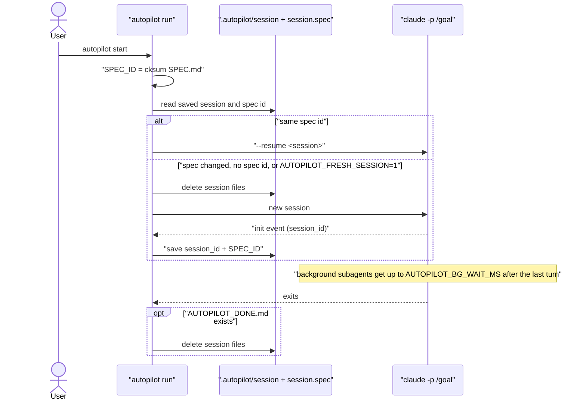
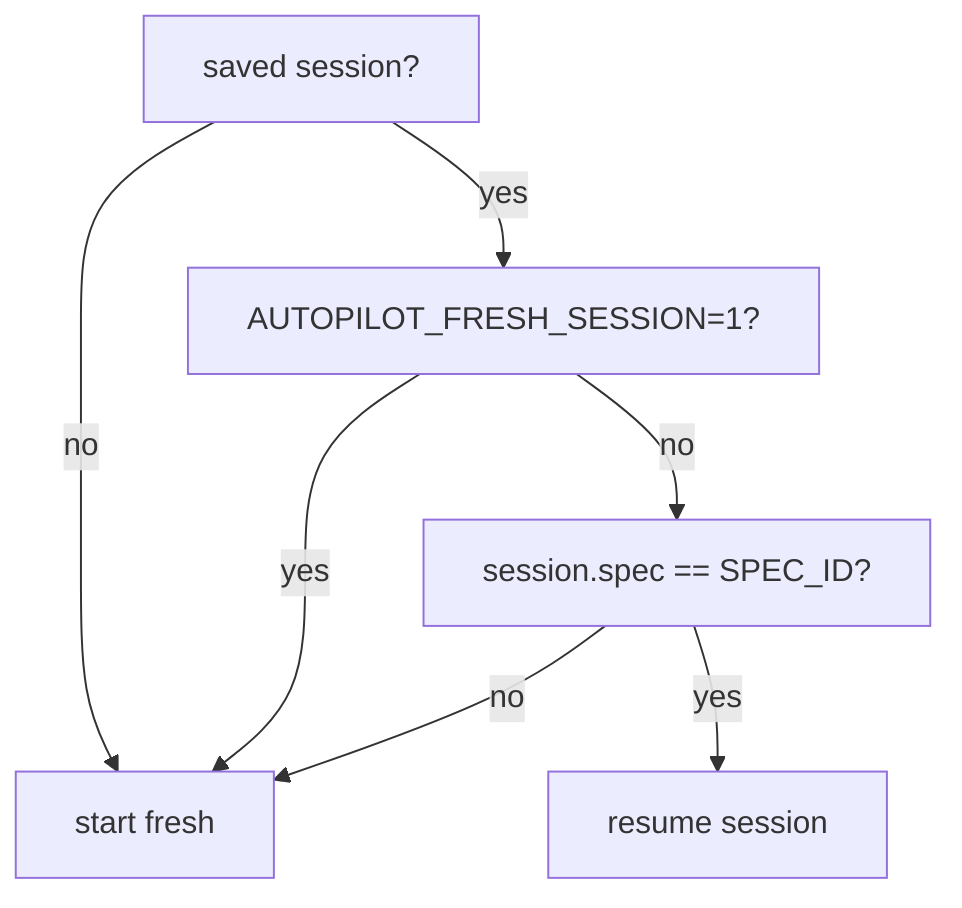

# Autopilot: one Claude session per spec, give background subagents time

## Summary
`autopilot start` resumed the session saved in `.autopilot/session` for every spec of a project, indefinitely. On a real project (nine specs over five days) the main agent's context reached 836K–913K tokens, so each of the 38 requests of the last run re-read ~840K cached tokens to write a few hundred. That run spent a whole usage window mostly on that overhead. Autopilot now ties a session to the SPEC.md it started on, and gives background subagents time to finish instead of stopping them 10 minutes after the last turn.

## Changes
- Runner: the session id is stored with a checksum of SPEC.md (`.autopilot/session.spec`). `select_session`, at the start of `run`, drops the saved session when SPEC.md differs, when no checksum exists (a session saved by an older runner), or with `AUTOPILOT_FRESH_SESSION=1`. A finished run (`AUTOPILOT_DONE.md`) clears the session. Restarts and usage-limit waits within one spec still resume (`home/bin/autopilot`).
- Runner: exports `CLAUDE_CODE_PRINT_BG_WAIT_CEILING_MS` (default 1 h, `AUTOPILOT_BG_WAIT_MS`). The goal now asks Claude to wait for its background subagents and stop idle dev servers before ending a turn (`home/bin/autopilot`).
- Tests: 9 new checks with the stub `claude` (`tests/run.sh`).
- Docs: guide 9 explains both mechanisms and adds "start on a fresh window" and "trust the folder" (`docs/09-autopilot.md`); the `/autopilot-spec` hand-off says each spec runs in a fresh session (`home/skills/autopilot-spec/SKILL.md`); `CHANGELOG.md`.

## How it works
`do_run` computes `SPEC_ID` once, before the loop. If a saved session exists and its recorded spec id matches, every attempt resumes it, as before. Otherwise the session is forgotten and the first attempt starts a new one; after it, the runner saves the new session id together with `SPEC_ID`. When the loop sees `AUTOPILOT_DONE.md` it deletes both files, so the next spec can never resume the finished conversation. State that must survive a fresh session already lives in the repo (commits, `PROGRESS.md`, `DECISIONS.md`).

## Verification
| Check | Command | Result |
|---|---|---|
| Test suite | `tests/run.sh` | 134 passed, 0 failed (9 new: bg wait default and override, goal text, done clears session, new spec fresh, same spec resumes, edited spec fresh, legacy session fresh, `AUTOPILOT_FRESH_SESSION=1`) |
| Shellcheck (as CI) | `shellcheck --severity=warning install.sh tests/run.sh home/statusline.sh home/hooks/*.sh home/bin/autopilot docs/assets/*.sh` | clean |
| Evidence for the cause | the affected project's `.autopilot/events.jsonl` (`result` events and per-request `usage`) | last run: 38 main-agent requests, 836K tokens of context on average, 913K max; one compaction in five days |

## Risks and follow-ups
- If Claude edits SPEC.md during a run and the user restarts it, the restart starts a fresh session. That is intended: the repo carries the state.
- Existing projects lose their saved session on the next `autopilot start` (no checksum recorded). That is the point of the fix.
- A background shell that never ends (a dev server the goal failed to stop) now delays the exit by up to 1 h instead of 10 min. No tokens are spent while waiting.
- Not done: a cap on context within one long spec. Compaction still handles that.
