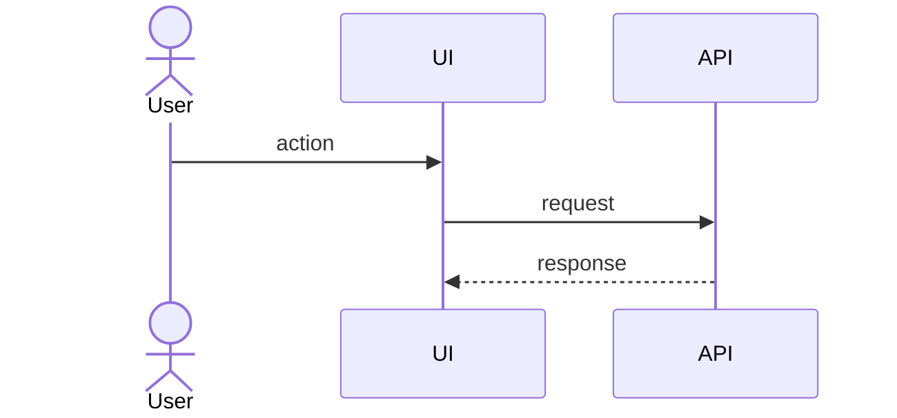

Open a pull request for the current branch. A PR without its doc is blocked by the `pr-doc-gate` hook, so always follow these steps. `$ARGUMENTS` may name the base branch or an issue to close.

## 1. Check the branch
- Never on the default branch. If you are, create a feature branch first and move the commits there.
- Base: `$ARGUMENTS` if it names one, else the remote's default branch (`git symbolic-ref --short refs/remotes/origin/HEAD`).
- The project's checks pass (run them; delegate long runs to the `verifier` subagent). Capture the commands and results. They go in the doc.
- Read the full diff against the base (`git diff <base>...HEAD`) and the commit messages.

## 2. Write the PR doc
Path: `docs/pr/<YYYY-MM-DD>-<branch-name-with-slashes-as-dashes>.md`. Update the existing one if this branch already has it.

~~~markdown
# <PR title>

## Summary
<2-4 sentences: what changed and why. Link the issue/spec it implements.>

## Changes
- <area>: <what changed> (`path/to/file`)

## How it works
<prose for the main flow, then diagrams>

## Verification
| Check | Command | Result |
|---|---|---|

## Risks and follow-ups
- <what could break, what was deliberately left out>
~~~

Diagram rules:
- **Always at least one `sequenceDiagram`** of the main runtime flow the PR adds or changes: request paths, jobs, CLI runs, event handling. For a change with no runtime flow (docs, config), diagram the workflow it affects, such as how the config is loaded and used.
- Add others **only when they explain something the prose can't**:
  - `flowchart` for decision logic, pipelines or component architecture;
  - `erDiagram` for schema or data-model changes;
  - `stateDiagram-v2` for lifecycles and status machines;
  - `classDiagram` for new types or module structure.
- Keep diagrams small, 5-15 nodes or messages each. Split big flows into several diagrams.
- Mermaid syntax that renders on GitHub: wrap labels containing `()[]{}:;,"` in double quotes; no HTML; `-->>` for replies; `Note over A,B: text` for annotations; `alt`/`opt`/`loop` blocks closed with `end`.
- Every diagram must match the code in the diff. Name real components, endpoints and functions, not placeholders.

Commit it: `git add docs/pr/... && git commit -m "Add PR doc for <branch>"`.

## 3. Push and open
- `git push -u origin <branch>` (pushing to the default branch is blocked by the guard hook, by design).
- `gh pr create --base <base> --title "<title>" --body-file <tmpfile>`, where the body is: the Summary, the main `sequenceDiagram` inline, a link to the doc on the branch (`docs/pr/<file>.md`), the Verification table, and `Closes #<n>` when there is an issue.
- Print the PR URL. Don't merge. Merging is the human's call.
